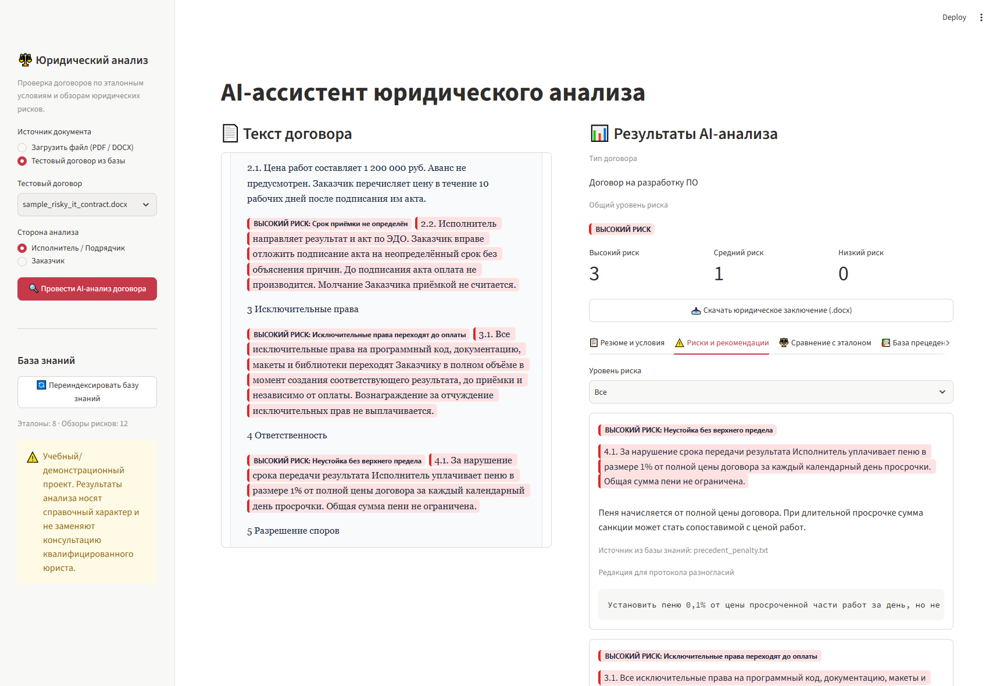

# ⚖️ AI-ассистент для юридического анализа договоров


Инструмент первичного скрининга B2B-договоров в PDF и DOCX. В двухпанельном интерфейсе (Split-View) юрист видит исходный текст рядом с замечаниями. Ассистент ищет релевантные выдержки из обзоров практики и эталонных шаблонов (RAG), сверяет дословные цитаты с договором и экспортирует заключение в Word.

## Проектная документация

- 📋 [Техническое задание (DOCX)](docs/Техническое_задание_AI_Юрист.docx) — цели, аудитория и её задачи, функциональные требования, архитектура, матрица рисков и критерии приёмки.
- 💼 [Бизнес-кейс проекта (Markdown)](docs/Бизнес_кейс_AI_Юрист.md) — бизнес-проблема, сценарий проверки IT-договора, целевые метрики пилота и варианты масштабирования.

## Ключевые возможности

- **Split-View.** Слева — договор с цветовой HTML-подсветкой рискованных цитат. Справа — резюме, ключевые условия, фильтр рисков, сравнение с эталоном и источники.
- **Позиция стороны.** Проверка учитывает интересы исполнителя или подрядчика либо заказчика.
- **RAG на ChromaDB.** Поиск сопоставляет условия с [эталонными шаблонами](data/templates/) и [обзорами практики и рисков](data/precedents/). В интерфейсе видны исходные фрагменты и их оценка релевантности.
- **Проверка цитат.** OpenAI Structured Outputs формирует ответ по схеме Pydantic. При различиях в пробелах, переносах, кавычках или тире приложение восстанавливает цитату из исходного текста договора перед подсветкой.
- **Материалы для согласования.** Карточки рисков содержат предлагаемые редакции для протокола разногласий. Итоговое заключение можно скачать в `.docx`.

## Структура проекта

```text
.
├── app.py                           # Интерфейс Streamlit и состояние сессии
├── config.py                        # Настройки OpenAI и пути проекта
├── README.md                        # Документация и запуск
├── requirements.txt                 # Зависимости Python
├── .env.example                     # Шаблон настроек без ключа
├── .gitignore                       # Исключения для секретов и локальных файлов
├── core/
│   ├── __init__.py
│   ├── parser.py                    # Извлечение текста из PDF и DOCX
│   ├── vector_store.py              # Индексация и поиск в ChromaDB
│   ├── analyzer.py                  # RAG, структурированный ответ и сверка цитат
│   └── report_gen.py                # Формирование заключения DOCX
├── data/
│   ├── templates/                   # Эталонные шаблоны договоров
│   ├── precedents/                  # Обзоры практики и рисков
│   └── sample_contracts/            # Два демонстрационных договора
├── docs/
│   ├── Техническое_задание_AI_Юрист.docx
│   ├── Бизнес_кейс_AI_Юрист.md
│   └── screenshots/                 # Скриншоты интерфейса и отчёта
└── scripts/
    └── generate_tz_docx.py           # Генератор технического задания
```

## Быстрый старт

Понадобятся Python 3.11 или новее, Git и ключ OpenAI для анализа и индексации. Если проект уже скачан, начните с создания окружения в корне проекта.

### PowerShell

```powershell
git clone https://github.com/alex-hash986/AI_yurist.git ai-lawyer
cd ai-lawyer
python -m venv .venv
.\.venv\Scripts\python.exe -m pip install -r requirements.txt
if (-not (Test-Path .env)) { Copy-Item .env.example .env }
```

Укажите свой `OPENAI_API_KEY` в `.env` и запустите приложение.

```powershell
.\.venv\Scripts\python.exe -m streamlit run app.py
```

### Bash

```bash
git clone https://github.com/alex-hash986/AI_yurist.git ai-lawyer
cd ai-lawyer
python3 -m venv .venv
source .venv/bin/activate
python -m pip install -r requirements.txt
[ -f .env ] || cp .env.example .env
```

Укажите свой `OPENAI_API_KEY` в `.env` и запустите приложение.

```bash
streamlit run app.py
```

### Проверка на тестовых договорах

1. В боковой панели выберите **Тестовый договор из базы**. [Договор на разработку ПО](data/sample_contracts/sample_risky_it_contract.docx) содержит спорные условия. [Договор маркетинговых услуг](data/sample_contracts/sample_balanced_services.docx) показывает сбалансированные формулировки.
2. Укажите позицию **Исполнитель / Подрядчик** или **Заказчик** и нажмите **Провести AI-анализ договора**. При первом запуске анализа пустые коллекции индексируются автоматически.
3. Сверьте замечания с подсвеченными цитатами и скачайте заключение. После обновления материалов базы используйте кнопку **Переиндексировать базу знаний**.

Просмотр документов доступен без ключа. PDF должен содержать текстовый слой. Индекс ChromaDB хранится локально. При анализе текст договора, поисковые запросы и выдержки базы передаются в OpenAI.

## Демонстрация работы

Скриншоты показывают интерфейс на тестовом договоре разработки ПО. Все изображения находятся в [docs/screenshots/](docs/screenshots/).

[](docs/screenshots/split_view_risks.png)

| Экран | Что показано |
| --- | --- |
| [Договор и риски](docs/screenshots/split_view_risks.png) | Дословные цитаты слева, обоснование и предлагаемые правки справа. |
| [Сравнение с эталоном](docs/screenshots/template_comparison.png) | Условие договора, эталонная формулировка и статус отклонения. |
| [Источники RAG](docs/screenshots/rag_sources.png) | Имена файлов, оценки релевантности и текст найденного фрагмента. |
| [Заключение DOCX](docs/screenshots/docx_report.png) | Предпросмотр скачанного отчёта с резюме и ключевыми условиями. |

## Юридический дисклеймер

> **Учебный и демонстрационный проект.** Используются публичные и синтетические шаблоны договоров. Выводы AI-ассистента носят справочный характер и не заменяют консультацию квалифицированного юриста.
